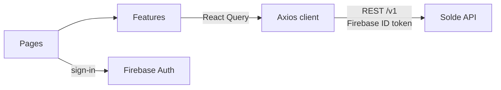

# Solde

Web app of **Solde**, a personal finance app: a monthly budget, debts between friends, savings in bank and cash, and vehicles bought together. You enter something once and every page that depends on it updates.

## Demo
https://github.com/user-attachments/assets/71b88293-b151-4137-8992-b61fa38ebab1

Backend (NestJS, PostgreSQL, Firebase Auth): [voit-api](https://github.com/Voit-admin/voit-api)

## Architecture



Each screen is a feature folder: a page, its components, its API hooks and its Zod schema.

```
src/
├── routes/           pages, file-based (TanStack Router)
├── features/
│   ├── budget/  dettes/  savings/  vehicles/  contacts/  subscriptions/  auth/
│   └── <feature>/    index.tsx, components/, api/<feature>-api.ts, data/schema.ts
├── components/       shadcn/ui components and shared layout
├── lib/              api client, Firebase, money, dates
└── locales/          English and French messages
```

## Key decisions

| Decision                                                                                          | Why                                                                      |
| ------------------------------------------------------------------------------------------------- | ------------------------------------------------------------------------ |
| [One Axios client](src/lib/api-client.ts) adds the Firebase ID token to every request             | A feature never handles authentication                                   |
| Each [API call](src/features/dettes/api/dettes-api.ts) parses the response with a Zod schema      | A change in the API shape fails at the boundary, not deep in a component |
| [Money stays in cents](src/lib/money.ts) with Dinero.js, and is formatted for the active language | No rounding error, and the amount reads the same way as the API sends it |
| [Lingui](src/i18n.ts) for English and French, with the language kept in a cookie                  | The whole interface is translated, and the choice survives a reload      |
| [File-based routes](src/routes) with code splitting (TanStack Router)                             | A new page is a new file, and each page loads only its own code          |
| [Table filters and pages in the URL](src/hooks/use-table-url-state.ts)                            | A filtered list can be shared or reloaded as it was                      |
| [shadcn/ui](src/components/ui) on Tailwind                                                        | One set of components, copied into the project and owned by it           |

## What it does

- **Monthly budget:** enter the salary, see what the fixed charges take and what is left, and set the remainder aside.
- **Recurring charges:** edit a charge without touching the months already generated.
- **Debts:** record a loan or a borrowing, add repayments, and search one contact to see what you owe each other in both directions.
- **Savings:** bank and cash balances with the history behind them.
- **Vehicles:** co-owners, shared expenses, the sale with the automatic split, and an Excel export of the investments.
- **Contacts:** the people you share money with.

## Run it locally

You need Node.js 20, [pnpm](https://pnpm.io/) and the running [API](https://github.com/Voit-admin/voit-api).

```sh
pnpm install
cp .env.example .env     # VITE_API_URL, VITE_FIREBASE_AUTH_EMULATOR_URL
pnpm dev                 # http://localhost:5173
```

Sign in with the account printed by the API seed. The Firebase web configuration is in [`src/lib/firebase.ts`](src/lib/firebase.ts): put your own project there if you do not use the emulator.

CI runs `pnpm lint`, `pnpm format:check` and `pnpm build`.

## What I'd improve

- Automated tests: there are none yet.
- Account creation: the app has a sign-in page and no sign-up page yet.

## Contact
